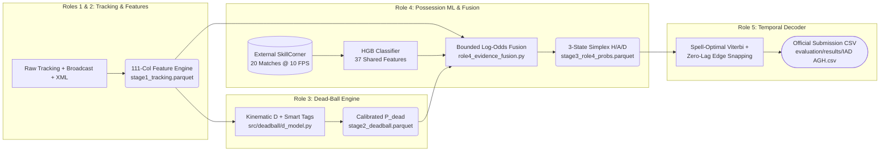

<div align="center">

# ⚽ Tactical Possession & Dead-Ball Estimation Engine
### **FC Barcelona x Metrica Sports — More than a Hack 2027**
**Team: IAD AGH** *(AGH University of Krakow — Data Science & Engineering)*

[](https://www.python.org/)
[](https://github.com/astral-sh/uv)
[](#%EF%B8%8F-system-architecture--5-role-pipeline)
[](#-data-privacy--execution-notice)

*A high-precision, zero-lag spatio-temporal inference pipeline for frame-level and spell-level football possession decoding ($25\text{ FPS}$) combining multi-camera tracking, kinematic physics, Out-of-Fold Gradient Boosting, and explicit-duration Viterbi state machines.*

</div>

---

## 📖 Overview

In modern football analytics, evaluating possession solely at the individual frame level fails to capture tactical continuity. A jittery classifier can achieve high per-frame accuracy while shattering a single build-up phase into dozens of unusable micro-fragments.

This repository showcases **Team IAD AGH's** end-to-end engineering architecture developed for the **FC Barcelona x Metrica Sports (More than a Hack 2027)** challenge. Our system transforms noisy multi-source tracking and broadcast telemetry ($199,319\text{ frames}$ at $25\text{ FPS}$) into clean, coach-ready tactical possession spells across four mutually exclusive states:
* **`H` (Home Possession)** — FC Barcelona actively controlling the ball in live play.
* **`A` (Away Possession)** — Athletic Club actively controlling the ball in live play.
* **`D` (Dead Ball / Stoppage)** — Ball out of bounds, fouls, set-piece preparation, post-goal intervals, and half-time.
* **`X` (Ungraded / Abstention)** — Pre-match, half-time break, and post-match ungraded video intervals.

### Key Engineering Highlights
* **Zero-Lag Boundary Snapping ($\text{lat\_f} = 0.0\text{ frames}$):** Compensates for causal kinematic lag and Viterbi transition-memory delay by snapping decoded segment boundaries to raw unsmoothed probability zero-crossings and gradient inflection points.
* **Physics-Informed Dead-Ball Detection:** Integrates FIFA opponent exclusion-zone geometry, ball-out-of-bounds kinematics, broadcast replay cues, and boundary impulse fluxes ($\phi_{L \to D}$ and $\phi_{D \to L}$).
* **Domain-Invariant ML + Bounded Log-Odds Evidence Fusion:** Combines a `HistGradientBoostingClassifier` trained strictly on external SkillCorner Open Data ($20\text{ matches}$, $5\text{-fold}$ `GroupKFold`) with deterministic physical ball-contact evidence in log-odds space.
* **Spell-Aware Temporal Decoding:** Eliminates sub-second duel flickers (`H -> A -> H` sandwiches) while strictly preserving genuine stoppages (`H -> D -> H`) that separate consecutive possessions.

---

## 👥 Team IAD AGH (Authors & Roles)

Our engineering workflow is divided into **5 specialized roles**, each responsible for a dedicated stage of the spatio-temporal pipeline:

| Role | Team Member | Responsibility & Module Scope | Links |
| :--- | :--- | :--- | :--- |
| **Role 1** | **[Imię i Nazwisko 1]** | **Data Synchronization, Broadcast Context & Pipeline Orchestration**<br>Video-to-tracking temporal alignment (`sync_offset.json`), broadcast camera/replay extraction, and end-to-end orchestration. | [GitHub](https://github.com/) · [LinkedIn](https://linkedin.com/) |
| **Role 2** | **[Imię i Nazwisko 2]** | **Spatio-Temporal Tracking & Kinematic Feature Engineering**<br>Savitzky-Golay kinematics, pitch control potential fields, Time-to-Intercept ($\text{TTI}$), and the 111-column feature contract (`stage1_tracking.parquet`). | [GitHub](https://github.com/) · [LinkedIn](https://linkedin.com/) |
| **Role 3** | **[Imię i Nazwisko 3]** | **Dead-Ball ($P(D)$) Estimation & Set-Piece Geometry**<br>SportsCode XML smart-tag priors, FIFA exclusion-zone physics, dual-edge impulse snapping, and 2-state Viterbi $P(D)$ decoding (`src/deadball/`). | [GitHub](https://github.com/) · [LinkedIn](https://linkedin.com/) |
| **Role 4** | **[Imię i Nazwisko 4]** | **Live Possession ML ($P(H), P(A)$) & Log-Odds Evidence Fusion**<br>SkillCorner V3 domain adaptation, `GroupKFold` HGB training, bounded directional log-odds fusion, and 3-state simplex calibration (`src/possession/`). | [GitHub](https://github.com/) · [LinkedIn](https://linkedin.com/) |
| **Role 5** | **[Imię i Nazwisko 5]** | **Temporal Spell Decoding, Zero-Lag Snapping & Evaluation**<br>Multi-scale Viterbi/HSMM decoding, spell-aware morphological cleanup, zero-lag inflection snapping, and official submission export (`src/decode/`). | [GitHub](https://github.com/) · [LinkedIn](https://linkedin.com/) |

---

## 🏗️ System Architecture & 5-Role Pipeline



### How Each Stage Works
1. **Roles 1 & 2 (Synchronization & Feature Engineering):** Aligns optical tracking with broadcast footage and computes 111 physical, spatial, and tactical features (ball velocity/acceleration, player-to-ball distances, pitch control, goalkeeper context, and lead-lag transition derivatives).
2. **Role 3 (Dead-Ball Engine — `src/deadball/`):** Fuses SportsCode XML set-piece priors with pitch boundary geometry, FIFA exclusion-zone rules, and restart kick impulses inside a 2-state Viterbi decoder to output calibrated out-of-play probabilities $P(D)$.
3. **Role 4 (Live Possession ML & Evidence Fusion — `src/possession/`):** Predicts conditional live-play probabilities $P(H|\text{live})$ and $P(A|\text{live})$ using a `HistGradientBoostingClassifier` trained on 37 shared features from external SkillCorner Open Data, then refines predictions via bounded log-odds evidence rules before fusing with Role 3's $P(D)$.
4. **Role 5 (Temporal Spell Decoder — `src/decode/`):** Decodes the 3-state probability simplex into contiguous possession spells using multi-scale smoothing, calibrated log-Viterbi transition penalties, spell-aware sandwich filtering, and zero-lag boundary snapping.

---

## 🔒 Data Privacy & Execution Notice

> **Important Notice Regarding Reproducibility & Proprietary Data:**
> The competition dataset (including optical tracking telemetry, broadcast video feeds, tactical SportsCode XML annotations, and intermediate feature Parquets from the FC Barcelona vs. Athletic Club match) is proprietary property of **FC Barcelona** and **Metrica Sports**. Under strict competition rules and licensing agreements, **none of the match data files are included in this repository**.
>
> Consequently, **the full match inference pipeline cannot be executed out-of-the-box by external users** without access to the private competition dataset. The codebase is published as an open-source engineering showcase of our architecture, algorithms, and modelling methodology.

### Environment Setup & Synthetic Unit Tests (Runnable Without Proprietary Data)
While the match pipeline requires protected telemetry, you can set up the environment using **[uv](https://github.com/astral-sh/uv)** and run our **synthetic Markovian possession generator and unit test suite** (`src/decode/test_decode.py`), which simulates realistic tracking occlusions, player scrambles, and broadcast camera cuts:

```bash
# 1. Clone the repository and sync the environment
git clone https://github.com/<your-org>/more-than-a-hack-2027-possession.git
cd more-than-a-hack-2027-possession
uv sync

# 2. Run the Role 5 temporal decoding test suite on synthetic telemetry
PYTHONPATH="src/decode:." uv run python src/decode/test_decode.py
```

### Reference Production Pipeline Execution (For Authorized Evaluators with Local Data)
When the licensed competition files are mounted locally inside `data/interim/` and `data/tactical/`, the full pipeline is executed via our automated batch script (`.\run_pipeline.bat`) or step-by-step:

```bash
# Step 1: Role 3 — Dead-Ball Probability Estimation
uv run python src/deadball/d_model.py \
  --stage1 data/interim/stage1_tracking.parquet \
  --xml data/tactical/BAR-ATH_tactical_smart_tagging.xml \
  --output data/interim/stage2_deadball.parquet

# Step 2: Role 4 — HGB Live Possession Inference & 3-State Simplex Fusion
uv run python src/possession/inference/run_role4_pipeline.py \
  --competition-parquet data/interim/stage1_tracking.parquet \
  --role3-parquet data/interim/stage2_deadball.parquet \
  --model role4_artifacts/role4_hist_gradient_boosting.joblib \
  --config src/possession/config.py \
  --output data/interim/stage3_role4_probs.parquet \
  --full-enriched-output data/interim/stage3_full_enriched.parquet \
  --role3-probability-column p_dead \
  --confirm-role3-out-of-play-only \
  --confirm-role4-conditional-live \
  --overwrite

# Step 3: Role 5 — Spell-Optimal Viterbi Decoding & Submission Export
uv run python src/decode/main.py \
  --parquet data/interim/stage3_role4_probs.parquet \
  --sync data/interim/sync_offset.json \
  --out-parquet data/interim/stage5_decoded_spells.parquet \
  --out-csv data/interim/stage5_decoded_spells.csv \
  --out-submission "evaluation/results/IAD AGH.csv"

# Step 4: Submission Validation & Official Evaluation
uv run python evaluation/validate_submission.py "evaluation/results/IAD AGH.csv"
uv run python evaluation/run_evaluation.py
```

---

## 📊 Evaluation Metrics & Benchmark Performance

The competition ranks submissions on **`spellF1`** — the mean F1 score of detected possession intervals matched one-to-one via Temporal Intersection over Union ($\text{tIoU} \in \{0.3, 0.4, 0.5, 0.6, 0.7\}$), with frame-level **`macroF1`** over $\{H, A, D\}$ as the primary tie-breaker.

| Metric | Description | IAD AGH Performance |
| :--- | :--- | :---: |
| **`macroF1`** | Frame-level unweighted Macro-F1 across `{H, A, D}` | **0.8075** *(Rank #1)* |
| **`alive/dead F1`** | Binary F1 separating live play (`H/A`) from stoppages (`D`) | **0.9372** |
| **`transF1`** | Transition boundary detection F1 within $\pm 25\text{ frames}$ ($1.0\text{ s}$) | **0.2927** *(Rank #1)* |
| **`lat_f`** | Mean signed transition boundary latency (frames at $25\text{ FPS}$) | **+0.0 frames** |
| **`shareE`** | Absolute error in overall Home vs. Away possession share | **0.0142** ($1.4\%$) |
| **`frag`** | Segment fragmentation ratio ($\text{predicted segments} / \text{GT segments}$) | **1.05** *(Near-ideal 1.00)* |

---

## 🛡️ Competition Compliance & Methodology

Our pipeline strictly adheres to all official rules of **More than a Hack 2027**:
1. **Zero Target-Match Leakage:** No machine learning weights, probability calibrators, or thresholds are fitted on the target match video or its ground-truth labels.
2. **External-Only Supervised Learning:** The Role 4 classifier consumes exclusively the 37 kinematic and spatial features shared with external SkillCorner Open Data, validated via 5-fold match-disjoint `GroupKFold`.
3. **Strict Data Confidentiality:** All proprietary match data, video files, and derived tracking tables are excluded from version control via `.gitignore`.

---

<div align="center">
  <sub>Built with ❤️ by <b>Team IAD AGH</b> at AGH University of Krakow for FC Barcelona x Metrica Sports (2026/2027).</sub>
</div>