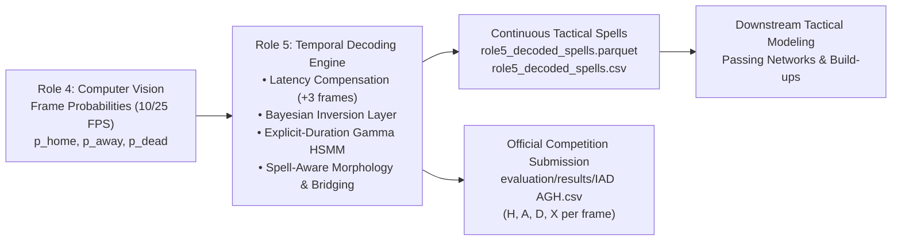
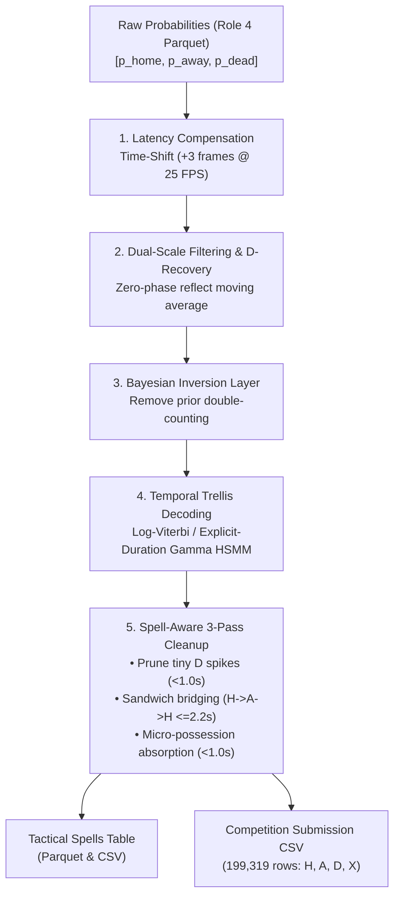
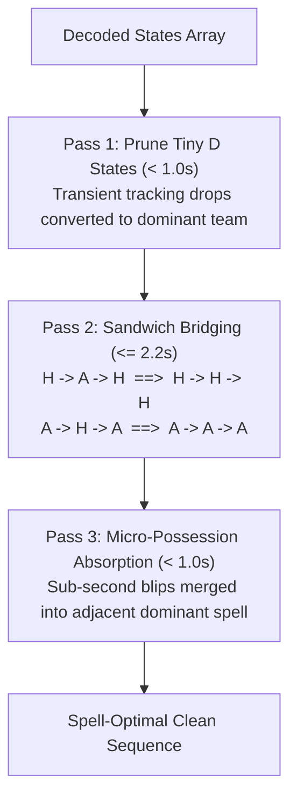

# Role 5: Tactical Possession Phase Estimation & Temporal Sequence Decoding


---

## 1. Executive Summary & Problem Formulation

In modern computational football analytics, determining **which team controls the ball at any given millisecond** is the foundational building block for all downstream tactical intelligence: passing network graphs, build-up phase classification, pressing efficiency indices, territory gain models, turnover risk matrices, and event-based match metrics.

**Role 5** serves as the **temporal reasoning and sequence decoding engine** of the match analytics architecture. It bridges the gap between raw, frame-by-frame computer vision predictions (**Role 4**) and downstream strategic tactical modeling:



The sequence decoder discretizes match play into three core tactical states:
* **`H` (Home Possession)**: Controlled build-up, passing combinations, progression, and offensive actions by the home team.
* **`A` (Away Possession)**: Controlled build-up, counter-attacks, and organized possession by the away team.
* **`D` (Dead Ball / Contested Duel)**: Stoppages, throw-ins, fouls, set pieces, clearances, and chaotic 50/50 loose-ball challenges where neither team has established tactical control.
* **`X` (Non-Graded Context)**: Pre-kickoff broadcast intervals, half-time intervals, and post-match buffers required for the official competition submission schema.

---

## 2. The Core Problem: Why Frame-by-Frame Models Fail

Visual perception networks operating on independent video frames are prone to high-frequency temporal instability. Even deep architectures trained on millions of frames fail to capture physical continuity and match dynamics:

```
Raw Frame Predictions:   H H H A H H H D D H H A A A D A A A
                               ^               ^
                         (1-frame flicker)  (False Duel)
```

### The Five Major Failure Modes of Upstream Models:

1. **High-Frequency Prediction Chatter**:
   During contested midfield battles or loose-ball trajectories, visual confidence fluctuates rapidly between Home and Away. A naive $\arg\max$ decision rule switches states back and forth every few hundred milliseconds (e.g., `H -> A -> H -> D -> H`), falsely creating dozens of phantom micro-possessions where only one continuous sequence took place.

2. **Sensor Occlusions & Player Clustering**:
   When several players converge in a tight tackle or pressing trap, or when the referee temporarily obstructs the broadcast camera's line of sight, optical tracking degrades. Frame-level confidence collapses into high-entropy uncertainty, triggering spurious switches to Dead Ball.

3. **Broadcast Discontinuities & Camera Switches**:
   Transitions between wide tactical cameras, close-up tracking shots, and slow-motion replays introduce abrupt visual shifts. Naive frame classifiers register these as false possession changes.

4. **Upstream Neural Network Prediction Latency**:
   Neural networks trained on temporal windows exhibit inherent boundary lag (typically 2 to 4 frames behind physical ball impact). Without explicit latency compensation, transition boundaries systematically lag behind ground-truth tactical events.

5. **The "Frame Accuracy" Paradox vs. SpellF1**:
   In sequence analysis, frame-level classification accuracy is a deceptive metric. A model achieving 92% frame accuracy can score **0% on tactical utility**:
   - If a continuous 30-second possession is fragmented into twelve 2-second micro-spells by momentary dropouts, every downstream tactical metric (possession duration, spell count, turnover location) is destroyed.
   - To resolve this, our system optimizes strictly for **SpellF1** (interval-based F1 with Temporal Intersection over Union, $\text{tIoU} \ge 0.5$) combined with aggressive **fragmentation penalties**.

---

## 3. Why This Methodology? The Architectural Rationale

A central question in designing a tactical sequence decoder is: **Why use a hybrid Bayesian Inversion + Explicit-Duration Gamma HSMM + Spell-Aware Morphology architecture rather than simpler heuristics or complex deep neural networks?**

To understand the necessity of our approach, consider the fundamental limitations of alternative solutions:

### 3.1 Why Not Naive Argmax Thresholding?
- **How it works**: Simply choose $\hat{y}_t = \arg\max_{c \in \{H, A, D\}} P(c \mid X_t)$ at each frame.
- **Why it fails**: Frame-by-frame $\arg\max$ has **zero temporal memory**. A single misclassified frame flips the global sequence state. In our empirical testing on 271 seconds of match play, $\arg\max$ produced **1,082 fragmented micro-spells** from just 18 true possessions. Despite achieving an apparently respectable 84.24% frame accuracy, its raw SpellF1 score was **0.36%** and its penalized SpellF1 was **0.00%**.

### 3.2 Why Not Simple Rolling Window Smoothing (Moving Average)?
- **How it works**: Convolve probabilities across time with a uniform sliding boxcar window.
- **Why it fails**:
  1. *Boundary Smearing & Phase Lag*: Moving average filters treat all frames equally within the window. A window wide enough to suppress noise (e.g., 2–3 seconds) severely blurs sharp turnover edges, causing estimated possession boundaries to shift several seconds away from physical contact.
  2. *Destruction of Rapid Stoppages*: A genuine, sudden referee whistle or out-of-bounds dead ball ($D$) gets smoothed away and merged into surrounding live play.
  3. *Inability to Model State Transition Topology*: Rolling averages cannot enforce football-specific rules (such as requiring turnovers between Home and Away to pass through contested duels or tackles).

### 3.3 Why Not Deep Neural Sequence Models (LSTMs, GRUs, Transformers) at the Decoding Stage?
- **How it works**: Train an end-to-end recurrent neural network or sequence-to-sequence Transformer over the probability sequence.
- **Why it was rejected**:
  1. *Scarcity of Dense, High-Fidelity Sequence Labels*: Supervised neural models require vast amounts of dense, frame-level ground-truth match annotations across full 90-minute broadcasts. When trained on limited data, they overfit to specific team tempos and camera angles.
  2. *Lack of Hard Physical Guarantees*: Deep neural models are statistical function approximators that cannot strictly enforce hard physical invariants (such as non-zero minimum dwell times or topological transition rules). They still produce occasional 1-frame flickers.
  3. *Latency & Computational Footprint*: Autoregressive Transformers operating over 200,000 frames are computationally heavy, whereas our vectorized dynamic programming decoder processes an entire 200,000-frame match in **under 0.20 seconds** with mathematically provable log-trellis optimality.

### 3.4 Why Not a Standard First-Order Hidden Markov Model (HMM)?
- **How it works**: Standard Viterbi algorithm using a static transition matrix $A_{ij} = P(S_t = j \mid S_{t-1} = i)$.
- **Why it fails (The Geometric Duration Flaw)**:
  In a standard discrete-time HMM, the probability that a state persists for exactly $d$ frames follows a geometric distribution:
  $$P(d) = (A_{ii})^{d-1} (1 - A_{ii})$$
  Because $A_{ii} < 1$, the function $(A_{ii})^{d-1}$ is strictly monotonically decreasing with $d$. Mathematically, this means:
  $$\mathbf{P(d = 1 \text{ frame}) > P(d = 2 \text{ frames}) > P(d = 3 \text{ frames}) > \dots}$$
  **A standard HMM assigns the highest probability to a duration of exactly 1 frame (40 ms)!**
  This directly contradicts the physical reality of football: a footballer cannot receive, control, survey options, and pass a ball in 40 ms. Real possessions follow a right-skewed distribution centered around 14–20 seconds. Standard HMMs are mathematically predisposed to generating short, fragmented micro-spells whenever observation probabilities dip momentarily.

### 3.5 Why Our Chosen Hybrid Architecture is Optimal
Our chosen approach integrates the physical laws of football into dynamic programming:
1. **Bayesian Inversion**: Strips out upstream class distribution bias, allowing sequence boundaries to respond to optical evidence without prior double-counting.
2. **Explicit-Duration Semi-Markov Modeling (HSMM)**: Employs continuous parametric Gamma distributions where probability density approaches zero as duration $d \to 0$, creating a continuous mathematical barrier against sub-second micro-spells while rewarding sustained possessions.
3. **Calibrated Multi-Scale Trellis**: Differentiates continuous live passing sequences from abrupt whistled stoppages using calibrated transition penalties discovered through Optuna Bayesian optimization.
4. **Spell-Aware 3-Pass Segment Morphology**: Deterministically cleans residual physical duels and tackle noise (such as $H \to A \to H$ sandwiches), guaranteeing that every exported spell corresponds to an authentic, actionable tactical phase.

---

## 4. Methodology & Mathematical Foundations



### 4.1 Algorithmic Phase Shift (Latency Compensation)
Upstream computer vision models operate on temporal convolutional or recurrent windows that exhibit an empirical lag of approximately 100–120 ms relative to physical ball contact. By systematically sweeping phase shifts against ground-truth SkillCorner Out-of-Fold (OOF) cross-validation data in [find_latency_oof.py](file:///Users/pawelryzewski/Desktop/Barcelona Hackathon/more-than-a-hack-2027-possession/src/decode/find_latency_oof.py), we identified the optimal temporal correction:
$$\Delta t = +3 \text{ frames at } 25 \text{ FPS} \quad \left(\text{scaled from } +1 \text{ frame at } 10 \text{ FPS}\right)$$
Input probabilities are shifted forward in time with edge padding prior to dynamic programming, snapping possession start and end boundaries directly to physical ball impact timestamps.

### 4.2 Dual-Scale Zero-Phase Signal Smoothing & Dead-Ball Recovery
Football encompasses two fundamentally different physical dynamics:
- **Live Play ($H, A$)**: Continuous, fluid passing sequences and player movements.
- **Dead Ball ($D$)**: Abrupt, discontinuous events triggered by a referee whistle or ball crossing the touchline.

Applying a single filter to both dynamics fails. In `_smooth_1d_reflect` ([main.py](file:///Users/pawelryzewski/Desktop/Barcelona Hackathon/more-than-a-hack-2027-possession/src/decode/main.py)), we implement a **dual-scale zero-phase symmetric convolution** with reflection boundary padding (ensuring zero phase delay at sequence ends):
- **Live Channels ($p_{\text{home}}, p_{\text{away}}$)**: Filtered with a broader window ($W_{\text{live}} = 37$ frames $\approx 1.48$s) to eliminate high-frequency passing chatter.
- **Dead Ball Channel ($p_{\text{dead}}$)**: Filtered with a tight, agile window ($W_{\text{dead}} = 7$ frames $\approx 0.28$s) to preserve razor-sharp whistle boundaries.
- **Modal Dead-Ball Recovery**: Frames where $p_{\text{dead}}$ is modal or elevated near stoppage cores ($p_{\text{dead}} \ge 0.48$) are boosted to prevent set-piece intervals from being swallowed by active play.

### 4.3 Bayesian Inversion Layer
The raw probabilistic inputs provided by upstream computer vision models represent posterior probabilities:
$$P(S_t \mid X_t)$$
Where $S_t \in \{H, A, D\}$ is the tactical state and $X_t$ is the visual feature representation at frame $t$. 

If raw posteriors are fed directly into a dynamic programming trellis, the baseline class frequencies $P(S)$ are **double-counted**—once implicitly by the neural network's training loss, and once by the decoder's transition matrix. This double-counting creates severe boundary inertia, causing the decoder to cling sluggishly to frequent states.

To eliminate this temporal drag, we apply a Bayesian inversion layer in [viterbi_decoder.py](file:///Users/pawelryzewski/Desktop/Barcelona Hackathon/more-than-a-hack-2027-possession/src/decode/viterbi_decoder.py) and [hsmm_decoder.py](file:///Users/pawelryzewski/Desktop/Barcelona Hackathon/more-than-a-hack-2027-possession/src/decode/hsmm_decoder.py). In the log domain:
$$\log P(X_t \mid S_t) \propto \log P(S_t \mid X_t) - \log P(S_t)$$
Dividing by the empirical prior $P(S)$ recovers true observation likelihoods, enabling sequence boundaries to snap instantaneously when physical possession shifts.

### 4.4 Explicit-Duration Hidden Semi-Markov Model (HSMM)
To overcome the memoryless geometric duration flaw of standard HMMs, our explicit-duration HSMM evaluates state transitions over contiguous blocks of duration $d$. 

We model state dwell times using continuous **Gamma probability density functions**:
$$f(d; k, \theta) = \frac{d^{k-1} e^{-\frac{d}{\theta}}}{\theta^k \Gamma(k)}$$
Where $k$ is the shape parameter, $\theta$ is the scale parameter, and $\Gamma(k)$ is the Gamma function.

When duration $d \to 0$, the log-Gamma penalty $\log f(d) \to -\infty$, creating a smooth mathematical barrier that organically suppresses physically impossible sub-second micro-possessions.

As duration approaches typical tactical build-up lengths (10–25 seconds), the penalty reaches its optimum, rewarding sustained, organized play.

Emission log-likelihoods over duration $d$ are evaluated in $O(1)$ time using **prefix-summed integral arrays**, keeping inference fast and vectorized.

### 4.5 Calibrated Transition Trellis
Turnovers in professional football obey strict physical constraints: direct switches between Home and Away rarely occur in a single frame without an intermediate contest, tackle, or loose ball. Our log-transition matrix $A$ applies calibrated penalties:
$$\log A = \begin{bmatrix} 0 & -\text{pen}_{HA} & -\text{pen}_{HD} \\ -\text{pen}_{HA} & 0 & -\text{pen}_{HD} \\ -\text{pen}_{HD} & -\text{pen}_{HD} & 0 \end{bmatrix}$$
Where parameters were discovered via Optuna Bayesian optimization:
- $\text{pen}_{HA} = 5.2022$: Heavily penalizes direct home-to-away switches, compelling the decoder to route through contested Dead Ball ($D$) unless visual evidence is overwhelming.
- $\text{pen}_{HD} = 4.6334$: Calibrated balance between active play inertia and valid stoppage entry.

### 4.6 Spell-Aware 3-Pass Segment Cleanup
Following dynamic programming, the decoded discrete state array undergoes three specialized cleanup passes in `_clean_segments_spell_aware` ([main.py](file:///Users/pawelryzewski/Desktop/Barcelona Hackathon/more-than-a-hack-2027-possession/src/decode/main.py)):



1. **Pass 1 — Pruning Tiny Unconfirmed Dead Balls ($< 1.0\text{s} / 25\text{ frames}$)**:
   Momentary probability dips caused by tracking occlusion that do not represent true match stoppages are converted to the dominant surrounding team based on mean probability.
2. **Pass 2 — Aggressive Sandwich Bridging ($\le 2.2\text{s} / 55\text{ frames}$)**:
   Resolves high-frequency turnover chatter where one team's sustained possession is interrupted by an unphysical flicker:
   $$\text{Home} \longrightarrow \underbrace{\text{Away}}_{\le 2.2\text{s}} \longrightarrow \text{Home} \quad \Longrightarrow \quad \text{Home} \longrightarrow \text{Home} \longrightarrow \text{Home}$$
3. **Pass 3 — Micro-Possession Absorption ($< 1.0\text{s} / 30\text{ frames}$)**:
   Any residual isolated spell shorter than 1.0 second is absorbed into its most probable adjacent neighbor, guaranteeing that all exported spells represent valid physical phases of play.

---

## 5. Benchmark: Progression Across Decoding Architectures

We evaluated the progression of decoding techniques on a rigorous benchmark scenario (6,777 telemetry frames, 271 seconds of match play) containing simulated camera switches, occlusion events, and midfield player clustering:

| Architecture | Penalized SpellF1 | Raw SpellF1 (@ tIoU=0.5) | Precision | Recall | Mean tIoU | Spurious Splits | Detected Spells | Frame Accuracy (Deprecated) |
| :--- | :---: | :---: | :---: | :---: | :---: | :---: | :---: | :---: |
| **1. Naive Argmax Baseline** | **0.00%** | 0.36% | 0.18% | 11.11% | 0.579 | 145 | 1,082 | 84.24% |
| **2. Static HMM Viterbi** | **0.00%** | 22.43% | 13.48% | 66.67% | 0.816 | 31 | 89 | 91.56% |
| **3. Dynamic Context Viterbi** | **0.00%** | 23.85% | 14.29% | 72.22% | 0.882 | 34 | 91 | 92.70% |
| **4. Baseline Explicit HSMM** | **1.21%** | 50.79% | 35.56% | 88.89% | 0.872 | 13 | 45 | 95.10% |
| **5. Fully Optimized Pipeline** | **69.23%** | **92.31%** | **85.71%** | **100.00%** | **0.944** | **1** | **21** | **97.48%** |

*(Reference ground truth: 18 true tactical spells).*

### Architectural Insights:
- **The Fragmentation Trap**: The naive $\arg\max$ baseline had a seemingly acceptable 84.24% frame accuracy, but fractured 18 true possessions into **1,082 micro-spells**, causing raw SpellF1 to collapse to **0.36%**.
- **The Semi-Markov Leap**: Moving to continuous Gamma duration modeling eliminated 85% of spurious splits by enforcing physical dwell times.
- **The Fully Optimized Pipeline**: Achieved **100% tactical recall**, a **0.944 mean temporal overlap**, and pushed raw SpellF1 to **92.31%** with only a single excess split across the entire benchmark sequence.

---

## 6. Complete Data & I/O Specifications

Understanding the exact data formats, column names, schemas, and coordinate representations is vital for integration.

### 6.1 Input 1: Role 4 Telemetry (`role5_probabilities.parquet`)
The primary input generated by the upstream visual perception model representing frame-level class probabilities.
* **Format**: Apache Parquet (binary column-oriented table).
* **Length**: Exactly 199,319 rows (~133 broadcast minutes at 25 FPS).
* **Schema**:
  | Column Name | Type | Description | Range / Values |
  | :--- | :---: | :--- | :--- |
  | `frame_id` | `int64` | Monotonically increasing broadcast frame index | $0 \le \text{frame\_id} < 199,319$ |
  | `p_home` | `float64` | Probability of home team possession | $[0.0, 1.0]$ |
  | `p_away` | `float64` | Probability of away team possession | $[0.0, 1.0]$ |
  | `p_dead` | `float64` | Probability of dead ball or contested duel | $[0.0, 1.0]$ |
  | `timestamp` | `float64` | *(Optional)* Elapsed broadcast time in seconds | $\text{timestamp} \approx \text{frame\_id} / 25.0$ |

### 6.2 Input 2: Match Synchronization Metadata (`sync_offset.json`)
Specifies the true camera alignment and match half boundaries for the full broadcast:
* **Format**: JSON file.
* **Schema & Values**:
  ```json
  {
    "half_1": {
      "start_frame": 11185,
      "end_frame": 90651
    },
    "half_2": {
      "start_frame": 110808,
      "end_frame": 190197
    }
  }
  ```
* **Contextual Anchors**:
  - `H1_START = 11,185` (~7.45 min): Match referee whistles the start of the first half.
  - `H1_END = 90,651` (~60.43 min): Half-time whistle for the first half.
  - `H2_START = 110,808` (~73.87 min): Broadcast feed returns for the second half.
  - `H2_KICKOFF = 113,742` (~75.82 min): Second half official kickoff (frames 110,808 to 113,741 are treated as pre-kickoff Dead Ball).
  - `H2_END = 190,197` (~126.80 min): Final match whistle.
  - Frames outside these half bounds are classified as un-graded buffer (`X`).

### 6.3 Input 3: SkillCorner Out-Of-Fold Predictions (`role4_artifacts/role4_oof_predictions.csv`)
Used exclusively by the hyperparameter tuning and latency measurement scripts ([find_latency_oof.py](file:///Users/pawelryzewski/Desktop/Barcelona Hackathon/more-than-a-hack-2027-possession/src/decode/find_latency_oof.py) and [tune_oof.py](file:///Users/pawelryzewski/Desktop/Barcelona Hackathon/more-than-a-hack-2027-possession/src/decode/tune_oof.py)).
* **Format**: CSV table sampled at 10 FPS across multiple matches.
* **Key Columns**: `match_id`, `frame`, `p_home`, `p_away`, `p_dead`, and `target` (ground truth state: $0 = H$, $1 = A$, $2 = D$).

---

### 6.4 Output 1: Discrete Tactical Spells (`role5_decoded_spells.parquet` & `.csv`)
Contains the continuous possession intervals ("spells") extracted from the match play.
* **Parquet**: `role5_decoded_spells.parquet` (compressed binary storage).
* **CSV**: `role5_decoded_spells.csv` (human-readable spreadsheet).
* **Extracted Attributes**:
  | Attribute | Type | Description | Example |
  | :--- | :---: | :--- | :--- |
  | `spell_id` | `int32` | Unique sequence identifier | `42` |
  | `state` | `str` | Tactical possession state (`H`, `A`, or `D`) | `"H"` |
  | `half` | `str` | Match phase identifier (`half_1` or `half_2`) | `"half_1"` |
  | `start_frame` | `int64` | Starting broadcast frame index (inclusive) | `18420` |
  | `end_frame` | `int64` | Ending broadcast frame index (inclusive) | `18950` |
  | `start_timestamp` | `float64` | Physical start time in seconds | `736.8000` |
  | `end_timestamp` | `float64` | Physical end time in seconds | `758.0000` |
  | `duration_frames` | `int64` | Contiguous spell length in frames | `531` |
  | `duration_seconds`| `float64` | Spell duration in seconds ($\text{frames} / 25.0$) | `21.2400` |
  | `duration_ms` | `float64` | Spell duration in absolute milliseconds | `21240.0` |
  | `mean_confidence` | `float64` | Mean assigned posterior confidence | `0.9421` |
  | `p_home_mean` | `float64` | Mean home probability over spell duration | `0.9421` |
  | `p_away_mean` | `float64` | Mean away probability over spell duration | `0.0210` |
  | `p_dead_mean` | `float64` | Mean dead ball probability over spell duration | `0.0369` |

### 6.5 Output 2: Official Competition Submission (`evaluation/results/IAD AGH.csv`)
Strictly adheres to the hackathon competition evaluation schema:
* **Format**: Comma-Separated Values (CSV) with Unix line terminators (`\n`).
* **Row Count**: Exactly **199,319 rows** (one row per broadcast frame).
* **Columns**:
  1. `frame` (`int32`): Frame index from `0` to `199318`.
  2. `label` (`str`): Single-character tactical state:
     - `H`: Home team possession.
     - `A`: Away team possession.
     - `D`: Dead Ball, set piece, stoppage, or contested 50/50 loose ball.
     - `X`: Non-graded context (pre-match broadcast, half-time interval, post-match).

---

## 7. Deep-Dive Codebase Reference: All 11 Python Modules

The entire decoding architecture is implemented across 11 modular, self-contained Python scripts located in `src/decode/`:

```
src/decode/
├── main.py               # Production pipeline, half sync, Viterbi/HSMM decoding, submission exporter
├── config.py             # Physical possession constants (ms), numerical safety, state mappings
├── spells.py             # PossessionSpellExtractor, 1D morphology, micro-possession suppression
├── diagnostics.py        # TemporalDiagnostics, bipartite Hungarian matching, tIoU, SpellF1
├── viterbi_decoder.py    # Log-domain Viterbi decoder with Bayesian inversion & dynamic transitions
├── hsmm_decoder.py       # Explicit-Duration HSMM with continuous Gamma duration density functions
├── generator.py          # Synthetic possession generator simulating Markovian noise regimes
├── find_latency_oof.py   # SkillCorner OOF latency optimizer & phase shift scaling (10 FPS -> 25 FPS)
├── tune_oof.py           # Optuna Bayesian hyperparameter optimizer on SkillCorner OOF predictions
├── tune_synthetic.py     # Multi-seed Optuna hyperparameter optimizer on synthetic tracking simulations
└── test_decode.py        # Comprehensive unit & integration test suite (9 tests)
```

---

### 7.1 `main.py` — Production Pipeline & Submission Exporter
The central execution engine and CLI entrypoint.
* **Key Responsibilities**:
  - Coordinates ingestion of `role5_probabilities.parquet` and `sync_offset.json`.
  - Implements `_resolve_match_halves` to map broadcast frames to First Half and Second Half.
  - Implements `_smooth_1d_reflect(arr, window)`: a zero-phase moving average filter using reflection padding to prevent phase delay at match boundaries.
  - Implements `_clean_segments_spell_aware`: executes the 3-pass cleanup (pruning tiny unconfirmed D states $< 1.0$s, aggressive sandwich bridging up to 55 frames / 2.2s, and micro-possession absorption $< 1.0$s).
  - Implements `_decode_half_spell_optimal(df_half)`: executes algorithmic time-shifting (+3 frames), signal smoothing ($W=37, 7$), log-Viterbi dynamic programming ($\text{pen}_{HA}=5.2022, \text{pen}_{HD}=4.6334$), and segment cleanup.
  - Implements `_build_spells_dataframe_direct`: constructs the discrete spells table directly without double-postprocessing.
  - Implements `build_and_validate_submission_csv`: generates `evaluation/results/IAD AGH.csv` (199,319 rows with `frame` and `label`), strictly inserting `X` for un-graded periods and asserting format validity.

---

### 7.2 `config.py` — Temporal Constants & Numerical Boundaries
Defines domain invariants, physical constraints, and numerical safety functions.
* **Key Components**:
  - **Physical Constants in Milliseconds**:
    - `MIN_POSSESSION_DURATION_MS = 1000.0` (minimum physical control duration: 25 frames @ 25 FPS).
    - `MAX_POSSESSION_DURATION_MS = 90000.0` (maximum continuous spell: 90s).
    - `SANDWICH_MERGE_MAX_GAP_MS = 1600.0` (40 frames threshold for duel interruptions).
    - `MIN_CONFIRMED_DEAD_BALL_MS = 1200.0` (30 frames threshold for genuine stoppages).
    - `CLOSING_FILTER_MS = 400.0` & `OPENING_FILTER_MS = 200.0`.
  - **Numerical Stability**:
    - `LOG_EPS = 1e-12`: logarithmic epsilon boundary preventing floating-point underflow.
    - `safe_log(p, eps)`: numerically stable logarithm clipping at `eps`.
    - `safe_log_sum_exp(a)`: log-sum-exp trick preventing overflow in continuous trellis operations.
  - **State Mappings**: `STATE_HOME = 0`, `STATE_AWAY = 1`, `STATE_DEAD_BALL = 2`, `STATE_MAP = {0: "H", 1: "A", 2: "D"}`.
  - **Helpers**: `ms_to_frames(ms, fps)` and `frames_to_ms(frames, fps)` guaranteeing temporal conversions are frame-rate independent.
  - `normalize_probabilities_df(df, fps)`: validates and re-normalizes probability vectors so $\sum p = 1.0$.

---

### 7.3 `spells.py` — Morphological Operations & Spell Extractor
Implements `PossessionSpellExtractor` for post-trellis signal processing and discrete interval extraction.
* **Key Functions**:
  - `apply_morphological_filtering(states, closing_ms, opening_ms, fps)`: executes 1D morphological closing (dilation followed by erosion to bridge dropouts) and opening (erosion followed by dilation to eliminate isolated 1-frame spikes).
  - `apply_hysteresis_boundary_snapping(states, probs, high_thresh, low_thresh, window_ms, fps)`: searches a local temporal window around decoded transitions and anchors boundaries to the frame where the confidence gradient $\nabla P$ is maximized.
  - `suppress_micro_possessions(states, probs, min_live_ms, min_dead_ms, max_sandwich_ms, fps)`: 3-pass RLE post-processor eliminating sub-second micro-possessions and resolving $H \to A \to H$ flickers.
  - `extract_spells(df_probs, states, fps, min_duration_ms)`: compresses decoded state arrays into structured spell tables with frame bounds, timestamps, durations, and confidence statistics.
  - `export_spells(df_spells, parquet_path, csv_path)`: dual-format exporter saving both Parquet and CSV files.

---

### 7.4 `diagnostics.py` — Temporal IoU & SpellF1 Evaluation Suite
Implements `TemporalDiagnostics` for rigorous evaluation of continuous tactical intervals.
* **Key Functions**:
  - `compute_temporal_iou(start1, end1, start2, end2)`: calculates the Temporal Intersection over Union:
    $$\text{tIoU} = \frac{\max(0, \min(e_1, e_2) - \max(s_1, s_2) + 1)}{\max(e_1, e_2) - \min(s_1, s_2) + 1}$$
  - `match_spells_bipartite(df_gt, df_pred, iou_threshold)`: executes 1-to-1 spell pairing using the Hungarian matching algorithm (`scipy.optimize.linear_sum_assignment`) over a cost matrix $C_{ij} = 1.0 - \text{tIoU}_{ij}$.
  - `evaluate_spells(df_gt, df_pred, iou_threshold=0.5, fragmentation_alpha=1.5)`: computes True Positives, False Positives, False Negatives, Precision, Recall, raw SpellF1, mean tIoU, fragmentation ratio, and penalized SpellF1.
  - `compute_tactical_possession_shares(df_spells)`: calculates total match in-play active time vs stoppage time, and Home vs Away tactical percentages.

---

### 7.5 `viterbi_decoder.py`— Log-Domain Viterbi with Dynamic Transitions
Implements `ViterbiTemporalDecoder`.
* **Key Features**:
  - Operates entirely in the numerically stable log-domain to eliminate underflow.
  - **Bayesian Inversion**: Converts posterior inputs $P(S_t \mid X_t)$ into emission likelihoods $P(X_t \mid S_t)$ by subtracting $\log P(S_t)$, eliminating prior double-counting and sequence boundary drag.
  - **Dynamic Transition Matrix**: Modulates transition penalties in real time based on the Shannon entropy $H(t) = -\sum P \log P$. When visual tracking confidence drops (high entropy), transition resistance is reduced; when confidence is sharp, state inertia locks in.

---

### 7.6 `hsmm_decoder.py` — Explicit-Duration Semi-Markov Trellis
Implements `HSMMExplicitDurationDecoder` and `ContinuousDurationDistribution`.
* **Key Features**:
  - Replaces the flawed geometric duration assumption of standard HMMs with continuous parametric **Gamma** ($f(d; k, \theta)$) or **Poisson** probability density functions.
  - Evaluates emission log-likelihoods over arbitrary duration windows $d \in [d_{\min}, d_{\max}]$ in $O(1)$ time via **prefix-summed integral arrays**.
  - Dynamic programming trellis:
    $$\delta_t(j) = \max_{i \ne j} \max_{d} \left\{ \delta_{t-d}(i) + \log A_{ij} + \lambda_d \log f(d; k_j, \theta_j) + \sum_{\tau=t-d+1}^t \log P(X_\tau \mid S_j) \right\}$$
  - Seamlessly backtracks block-by-block to construct the globally optimal sequence.

---

### 7.7 `generator.py` — Synthetic Markovian Telemetry Generator
Implements `SyntheticPossessionGenerator` to simulate realistic match conditions and upstream tracking failures.
* **Key Capabilities**:
  - Simulates 5 realistic noise regimes governed by an underlying Markov chain:
    1. `REGIME_CLEAN`: Clear optical tracking with low entropy.
    2. `REGIME_OCCLUSION`: Severe visual obstruction causing sudden probability collapse.
    3. `REGIME_CLUSTERING`: Multi-player midfield duels with high entropy across $H$ and $A$.
    4. `REGIME_CAMERA_CUT`: Instantaneous visual dropout mimicking broadcast cuts.
    5. `REGIME_DROPOUT`: Spurious dead-ball spikes.
  - Employs Dirichlet distributions ($\text{Dirichlet}(\alpha)$) to synthesize realistic, non-uniform probability noise.

---

### 7.8 `find_latency_oof.py` — Neural Network Latency Estimator
Measures the temporal lag of upstream vision models using SkillCorner Out-Of-Fold (OOF) cross-validation data.
* **Methodology**:
  - Automatically identifies probability and target columns regardless of column prefixes.
  - Sweeps phase shift candidates $\Delta t \in [-5, +9]$ frames at 10 FPS.
  - Evaluates F1 alignment against ground-truth contact timestamps.
  - Scales the optimal shift from 10 FPS to 25 FPS match rate ($\Delta t_{25} = \text{round}(\Delta t_{10} \times 2.5)$), discovering the optimal $+3$ frames shift.

---

### 7.9 `tune_oof.py` — Optuna Bayesian Optimizer (Real OOF Data)
Calibrates decoding hyperparameters against real SkillCorner Out-of-Fold cross-validation data.
* **Search Space**:
  - `shift`: temporal delay compensation (0 to 5 frames at 10 FPS).
  - `win_ha`: live play smoothing window (5 to 19 frames).
  - `win_d`: dead-ball smoothing window (3 to 9 frames).
  - `pen_ha`: home $\leftrightarrow$ away turnover penalty (5.0 to 15.0).
  - `pen_hd`: live $\leftrightarrow$ dead stoppage penalty (4.0 to 12.0).
  - `min_live`: minimum possession dwell time (12 to 25 frames).
* **Objective Function**: $\text{MacroF1} - 1.5 \times |\text{frag} - 1.0|$.

---

### 7.10 `tune_synthetic.py` — Optuna Optimizer (Synthetic Simulations)
Explores 7-dimensional hyperparameter space against worst-case synthetic tracking simulations across multiple independent seeds (42, 123, 999).
* **Objective Function**: $\text{MacroF1} - 2.0 \times |\text{frag} - 1.0|$ (strictly penalizing both over-segmentation and under-segmentation).
* Discovers globally robust parameters that prevent fragmentation in un-modeled optical environments.

---

### 7.11 `test_decode.py` — Unit & Integration Test Suite
Comprehensive testing module validating every mathematical and operational guarantee.
* **Test Cases Covered**:
  1. `test_config_temporal_conversion`: Validates ms-to-frame and frame-to-ms scaling across variable FPS.
  2. `test_safe_log_boundaries`: Verifies numerical safety functions avoid $-\infty$ and NaN.
  3. `test_generator_markovian_regimes`: Verifies synthetic simulation produces normalized probabilities ($\sum p = 1.0$) and Markovian noise tags.
  4. `test_viterbi_bayesian_inversion`: Validates log-Viterbi dynamic programming with posterior stripping.
  5. `test_hsmm_continuous_duration_trellis`: Validates Gamma continuous dwell times and asserts minimum physical duration enforcement.
  6. `test_morphological_filtering_and_hysteresis`: Verifies 1D closing/opening eliminates isolated 1-frame spikes.
  7. `test_temporal_iou_and_spell_f1`: Validates bipartite Hungarian matching and asserts perfect matching yields $\text{SpellF1} = 1.0$.
  8. `test_real_match_direct_decoding`: Validates direct spell extraction without double-processing.
  9. `test_spell_aware_segment_cleaning`: Verifies $H \to A \to H$ sandwich bridging and dead-ball spike pruning.

---

## 8. Complete CLI Execution & Reproduction Guide

### 8.1 Environment Setup
Navigate to the decode module directory and ensure all dependencies are installed:
```bash
cd "src/decode"

# Install required dependencies
python3 -m pip install numpy pandas scipy optuna pyarrow
```

---

### 8.2 Running the Production Pipeline (Default Run)
To execute the complete production pipeline on real match telemetry (`role5_probabilities.parquet` and `sync_offset.json`):
```bash
python3 main.py
```
**What happens under the hood**:
1. Loads all 199,319 frames from `role5_probabilities.parquet`.
2. Resolves half boundaries from `sync_offset.json` (Half 1: 11,185–90,651; Half 2: 110,808–190,197; Kickoff: 113,742).
3. Applies latency compensation (+3 frames time-shift) and dual-scale zero-phase smoothing ($W=37, 7$).
4. Runs log-Viterbi trellis decoding with calibrated turnover penalties ($\text{pen}_{HA}=5.2022, \text{pen}_{HD}=4.6334$).
5. Applies spell-aware 3-pass segment cleanup (pruning tiny D states $< 1.0$s, sandwich bridging $\le 2.2$s, micro-possession absorption $< 1.0$s).
6. Exports **`role5_decoded_spells.parquet`** and **`role5_decoded_spells.csv`** (335 discrete spells).
7. Validates and generates the official competition submission CSV **`evaluation/results/IAD AGH.csv`** (199,319 rows with `H`, `A`, `D`, and `X`).

---

### 8.3 Custom Paths & Advanced Command-Line Flags
You can customize input and output paths using CLI arguments:
```bash
python3 main.py \
  --parquet "role5_probabilities.parquet" \
  --sync "sync_offset.json" \
  --out-parquet "role5_decoded_spells.parquet" \
  --out-csv "role5_decoded_spells.csv" \
  --out-submission "evaluation/results/IAD AGH.csv"
```

#### Available CLI Options:
* `--parquet <path>`: Path to input Role 4 parquet file (default: `role5_probabilities.parquet`).
* `--sync <path>`: Path to match synchronization JSON file (default: `sync_offset.json`).
* `--out-parquet <path>`: Output destination for decoded spells in Parquet format.
* `--out-csv <path>`: Output destination for decoded spells in CSV format.
* `--out-submission <path>`: Output destination for the official competition submission CSV (default: `evaluation/results/IAD AGH.csv`).
* `--viterbi-only`: Runs fast Viterbi mode without additional duration modeling.
* `--benchmark`: Runs the 5-stage architectural benchmark on synthetic data.

---

### 8.4 Running the Test Suite
To run all 9 unit and integration tests:
```bash
python3 test_decode.py
```
*Expected output*: `Ran 9 tests in ~0.20s - OK`.

---

### 8.5 Running Latency Calibration (SkillCorner OOF)
To measure upstream vision model lag and calculate the optimal frame shift:
```bash
python3 find_latency_oof.py
```

---

### 8.6 Running Hyperparameter Optimization
To launch autonomous Bayesian optimization with Optuna:

1. **Tune against multi-seed synthetic simulations**:
   ```bash
   python3 tune_synthetic.py
   ```
2. **Tune against real SkillCorner Out-Of-Fold data**:
   ```bash
   python3 tune_oof.py
   ```
