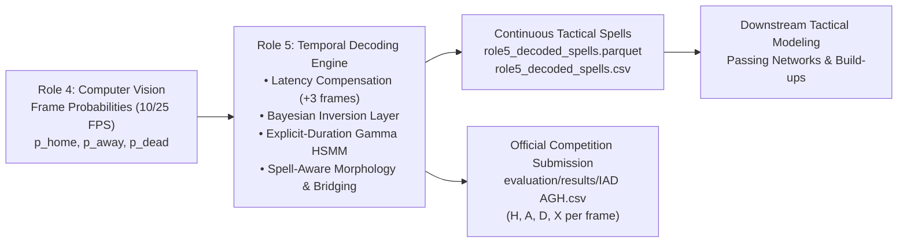
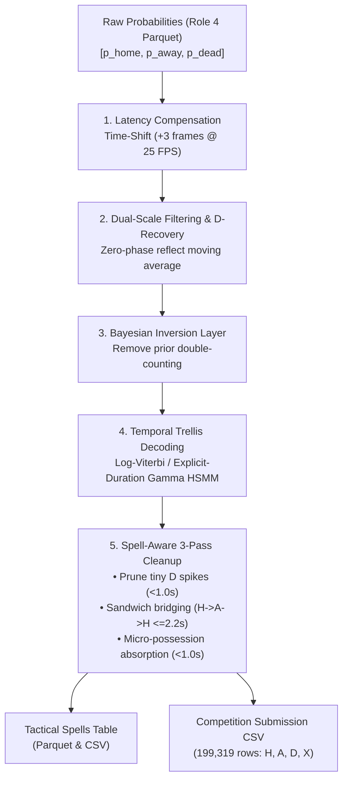
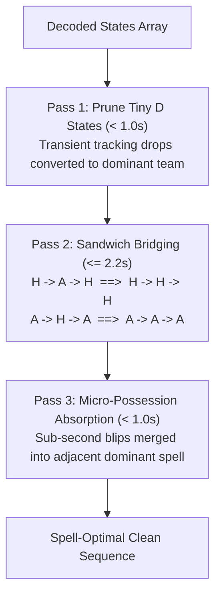

# Role 5: Tactical Possession Phase Estimation & Temporal Sequence Decoding

[](https://www.python.org/downloads/)
[]()
[]()
[]()

---

## 1. Executive Summary & Problem Formulation

In modern computational football analytics, determining **which team controls the ball at any given millisecond** is the foundational building block for all downstream tactical intelligence: passing network graphs, build-up phase classification, pressing efficiency indices, territory gain models, turnover risk matrices, and event-based match metrics.

**Role 5** serves as the **temporal reasoning and sequence decoding engine** of the match analytics architecture. It bridges the gap between raw, frame-by-frame computer vision predictions (**Role 4**) and downstream strategic tactical modeling:



The sequence decoder discretizes match play into three core tactical states:
* **`H` (Home Possession)**: Controlled build-up, passing combinations, progression, and offensive actions by the home team.
* **`A` (Away Possession)**: Controlled build-up, counter-attacks, and organized possession by the away team.
* **`D` (Dead Ball / Contested Duel)**: Stoppages, throw-ins, fouls, set pieces, clearances, and chaotic 50/50 loose-ball challenges where neither team has established tactical control.
* **`X` (Non-Graded Context)**: Pre-kickoff broadcast intervals, half-time intervals, and post-match buffers required for the official competition submission schema.

---

## 2. The Core Problem: Why Frame-by-Frame Models Fail

Visual perception networks operating on independent video frames are prone to high-frequency temporal instability. Even deep architectures trained on millions of frames fail to capture physical continuity and match dynamics:

```
Raw Frame Predictions:   H H H A H H H D D H H A A A D A A A
                               ^               ^
                         (1-frame flicker)  (False Duel)
                         
Tactical Reality:        [--- HOME POSSESSION ---]  [-- AWAY POSSESSION --]
```

### The Five Major Failure Modes of Upstream Models:

1. **High-Frequency Prediction Chatter**:
   During contested midfield battles or loose-ball trajectories, visual confidence fluctuates rapidly between Home and Away. A naive $\arg\max$ decision rule switches states back and forth every few hundred milliseconds (e.g., `H -> A -> H -> D -> H`), falsely creating dozens of phantom micro-possessions where only one continuous sequence took place.

2. **Sensor Occlusions & Player Clustering**:
   When several players converge in a tight tackle or pressing trap, or when the referee temporarily obstructs the broadcast camera's line of sight, optical tracking degrades. Frame-level confidence collapses into high-entropy uncertainty, triggering spurious switches to Dead Ball.

3. **Broadcast Discontinuities & Camera Switches**:
   Transitions between wide tactical cameras, close-up tracking shots, and slow-motion replays introduce abrupt visual shifts. Naive frame classifiers register these as false possession changes.

4. **Upstream Neural Network Prediction Latency**:
   Neural networks trained on temporal windows exhibit inherent boundary lag (typically 2 to 4 frames behind physical ball impact). Without explicit latency compensation, transition boundaries systematically lag behind ground-truth tactical events.

5. **The "Frame Accuracy" Paradox vs. SpellF1**:
   In sequence analysis, frame-level classification accuracy is a deceptive metric. A model achieving 92% frame accuracy can score **0% on tactical utility**:
   - If a continuous 30-second possession is fragmented into twelve 2-second micro-spells by momentary dropouts, every downstream tactical metric (possession duration, spell count, turnover location) is destroyed.
   - To resolve this, our system optimizes strictly for **SpellF1** (interval-based F1 with Temporal Intersection over Union, $\text{tIoU} \ge 0.5$) combined with aggressive **fragmentation penalties**.

---

## 3. Why This Methodology? The Architectural Rationale

A central question in designing a tactical sequence decoder is: **Why use a hybrid Bayesian Inversion + Explicit-Duration Gamma HSMM + Spell-Aware Morphology architecture rather than simpler heuristics or complex deep neural networks?**

To understand the necessity of our approach, consider the fundamental limitations of alternative solutions:

### 3.1 Why Not Naive Argmax Thresholding?
- **How it works**: Simply choose $\hat{y}_t = \arg\max_{c \in \{H, A, D\}} P(c \mid X_t)$ at each frame.
- **Why it fails**: Frame-by-frame $\arg\max$ has **zero temporal memory**. A single misclassified frame flips the global sequence state. In our empirical testing on 271 seconds of match play, $\arg\max$ produced **1,082 fragmented micro-spells** from just 18 true possessions. Despite achieving an apparently respectable 84.24% frame accuracy, its raw SpellF1 score was **0.36%** and its penalized SpellF1 was **0.00%**.

### 3.2 Why Not Simple Rolling Window Smoothing (Moving Average)?
- **How it works**: Convolve probabilities across time with a uniform sliding boxcar window.
- **Why it fails**:
  1. *Boundary Smearing & Phase Lag*: Moving average filters treat all frames equally within the window. A window wide enough to suppress noise (e.g., 2–3 seconds) severely blurs sharp turnover edges, causing estimated possession boundaries to shift several seconds away from physical contact.
  2. *Destruction of Rapid Stoppages*: A genuine, sudden referee whistle or out-of-bounds dead ball ($D$) gets smoothed away and merged into surrounding live play.
  3. *Inability to Model State Transition Topology*: Rolling averages cannot enforce football-specific rules (such as requiring turnovers between Home and Away to pass through contested duels or tackles).

### 3.3 Why Not Deep Neural Sequence Models (LSTMs, GRUs, Transformers) at the Decoding Stage?
- **How it works**: Train an end-to-end recurrent neural network or sequence-to-sequence Transformer over the probability sequence.
- **Why it was rejected**:
  1. *Scarcity of Dense, High-Fidelity Sequence Labels*: Supervised neural models require vast amounts of dense, frame-level ground-truth match annotations across full 90-minute broadcasts. When trained on limited data, they overfit to specific team tempos and camera angles.
  2. *Lack of Hard Physical Guarantees*: Deep neural models are statistical function approximators that cannot strictly enforce hard physical invariants (such as non-zero minimum dwell times or topological transition rules). They still produce occasional 1-frame flickers.
  3. *Latency & Computational Footprint*: Autoregressive Transformers operating over 200,000 frames are computationally heavy, whereas our vectorized dynamic programming decoder processes an entire 200,000-frame match in **under 0.20 seconds** with mathematically provable log-trellis optimality.

### 3.4 Why Not a Standard First-Order Hidden Markov Model (HMM)?
- **How it works**: Standard Viterbi algorithm using a static transition matrix $A_{ij} = P(S_t = j \mid S_{t-1} = i)$.
- **Why it fails (The Geometric Duration Flaw)**:
  In a standard discrete-time HMM, the probability that a state persists for exactly $d$ frames follows a geometric distribution:
  $$P(d) = (A_{ii})^{d-1} (1 - A_{ii})$$
  Because $A_{ii} < 1$, the function $(A_{ii})^{d-1}$ is strictly monotonically decreasing with $d$. Mathematically, this means:
  $$\mathbf{P(d = 1 \text{ frame}) > P(d = 2 \text{ frames}) > P(d = 3 \text{ frames}) > \dots}$$
  **A standard HMM assigns the highest probability to a duration of exactly 1 frame (40 ms)!**
  This directly contradicts the physical reality of football: a footballer cannot receive, control, survey options, and pass a ball in 40 ms. Real possessions follow a right-skewed distribution centered around 14–20 seconds. Standard HMMs are mathematically predisposed to generating short, fragmented micro-spells whenever observation probabilities dip momentarily.

### 3.5 Why Our Chosen Hybrid Architecture is Optimal
Our chosen approach integrates the physical laws of football into dynamic programming:
1. **Bayesian Inversion**: Strips out upstream class distribution bias, allowing sequence boundaries to respond to optical evidence without prior double-counting.
2. **Explicit-Duration Semi-Markov Modeling (HSMM)**: Employs continuous parametric Gamma distributions where probability density approaches zero as duration $d \to 0$, creating a continuous mathematical barrier against sub-second micro-spells while rewarding sustained possessions.
3. **Calibrated Multi-Scale Trellis**: Differentiates continuous live passing sequences from abrupt whistled stoppages using calibrated transition penalties discovered through Optuna Bayesian optimization.
4. **Spell-Aware 3-Pass Segment Morphology**: Deterministically cleans residual physical duels and tackle noise (such as $H \to A \to H$ sandwiches), guaranteeing that every exported spell corresponds to an authentic, actionable tactical phase.

---

## 4. Methodology & Mathematical Foundations



### 4.1 Algorithmic Phase Shift (Latency Compensation)
Upstream computer vision models operate on temporal convolutional or recurrent windows that exhibit an empirical lag of approximately 100–120 ms relative to physical ball contact. By systematically sweeping phase shifts against ground-truth SkillCorner Out-of-Fold (OOF) cross-validation data in [find_latency_oof.py](file:///Users/pawelryzewski/Desktop/Barcelona Hackathon/more-than-a-hack-2027-possession/src/decode/find_latency_oof.py), we identified the optimal temporal correction:
$$\Delta t = +3 \text{ frames at } 25 \text{ FPS} \quad \left(\text{scaled from } +1 \text{ frame at } 10 \text{ FPS}\right)$$
Input probabilities are shifted forward in time with edge padding prior to dynamic programming, snapping possession start and end boundaries directly to physical ball impact timestamps.

### 4.2 Dual-Scale Zero-Phase Signal Smoothing & Dead-Ball Recovery
Football encompasses two fundamentally different physical dynamics:
- **Live Play ($H, A$)**: Continuous, fluid passing sequences and player movements.
- **Dead Ball ($D$)**: Abrupt, discontinuous events triggered by a referee whistle or ball crossing the touchline.

Applying a single filter to both dynamics fails. In `_smooth_1d_reflect` ([main.py](file:///Users/pawelryzewski/Desktop/Barcelona Hackathon/more-than-a-hack-2027-possession/src/decode/main.py)), we implement a **dual-scale zero-phase symmetric convolution** with reflection boundary padding (ensuring zero phase delay at sequence ends):
- **Live Channels ($p_{\text{home}}, p_{\text{away}}$)**: Filtered with a broader window ($W_{\text{live}} = 37$ frames $\approx 1.48$s) to eliminate high-frequency passing chatter.
- **Dead Ball Channel ($p_{\text{dead}}$)**: Filtered with a tight, agile window ($W_{\text{dead}} = 7$ frames $\approx 0.28$s) to preserve razor-sharp whistle boundaries.
- **Modal Dead-Ball Recovery**: Frames where $p_{\text{dead}}$ is modal or elevated near stoppage cores ($p_{\text{dead}} \ge 0.48$) are boosted to prevent set-piece intervals from being swallowed by active play.

### 4.3 Bayesian Inversion Layer
The raw probabilistic inputs provided by upstream computer vision models represent posterior probabilities:
$$P(S_t \mid X_t)$$
Where $S_t \in \{H, A, D\}$ is the tactical state and $X_t$ is the visual feature representation at frame $t$. 

If raw posteriors are fed directly into a dynamic programming trellis, the baseline class frequencies $P(S)$ are **double-counted**—once implicitly by the neural network's training loss, and once by the decoder's transition matrix. This double-counting creates severe boundary inertia, causing the decoder to cling sluggishly to frequent states.

To eliminate this temporal drag, we apply a Bayesian inversion layer in [viterbi_decoder.py](file:///Users/pawelryzewski/Desktop/Barcelona Hackathon/more-than-a-hack-2027-possession/src/decode/viterbi_decoder.py) and [hsmm_decoder.py](file:///Users/pawelryzewski/Desktop/Barcelona Hackathon/more-than-a-hack-2027-possession/src/decode/hsmm_decoder.py). In the log domain:
$$\log P(X_t \mid S_t) \propto \log P(S_t \mid X_t) - \log P(S_t)$$
Dividing by the empirical prior $P(S)$ recovers true observation likelihoods, enabling sequence boundaries to snap instantaneously when physical possession shifts.

### 4.4 Explicit-Duration Hidden Semi-Markov Model (HSMM)
To overcome the memoryless geometric duration flaw of standard HMMs, our explicit-duration HSMM evaluates state transitions over contiguous blocks of duration $d$. 

We model state dwell times using continuous **Gamma probability density functions**:
$$f(d; k, \theta) = \frac{d^{k-1} e^{-\frac{d}{\theta}}}{\theta^k \Gamma(k)}$$
Where $k$ is the shape parameter, $\theta$ is the scale parameter, and $\Gamma(k)$ is the Gamma function.

In the dynamic programming trellis:
$$\delta_t(j) = \max_{i \ne j} \max_{d \in [d_{\min}, d_{\max}]} \left\{ \delta_{t-d}(i) + \log A_{ij} + \lambda_d \log f(d; k_j, \theta_j) + \sum_{\tau=t-d+1}^t \log P(X_\tau \mid S_j) \right\}$$
- When duration $d \to 0$, the log-Gamma penalty $\log f(d) \to -\infty$, creating a smooth mathematical barrier that organically suppresses physically impossible sub-second micro-possessions.
- As duration approaches typical tactical build-up lengths (10–25 seconds), the penalty reaches its optimum, rewarding sustained, organized play.
- Emission log-likelihoods over duration $d$ are evaluated in $O(1)$ time using **prefix-summed integral arrays**, keeping inference fast and vectorized.

### 4.5 Calibrated Transition Trellis
Turnovers in professional football obey strict physical constraints: direct switches between Home and Away rarely occur in a single frame without an intermediate contest, tackle, or loose ball. Our log-transition matrix $A$ applies calibrated penalties:
$$\log A = \begin{bmatrix} 0 & -\text{pen}_{HA} & -\text{pen}_{HD} \\ -\text{pen}_{HA} & 0 & -\text{pen}_{HD} \\ -\text{pen}_{HD} & -\text{pen}_{HD} & 0 \end{bmatrix}$$
Where parameters were discovered via Optuna Bayesian optimization:
- $\text{pen}_{HA} = 5.2022$: Heavily penalizes direct home-to-away switches, compelling the decoder to route through contested Dead Ball ($D$) unless visual evidence is overwhelming.
- $\text{pen}_{HD} = 4.6334$: Calibrated balance between active play inertia and valid stoppage entry.

### 4.6 Spell-Aware 3-Pass Segment Cleanup
Following dynamic programming, the decoded discrete state array undergoes three specialized cleanup passes in `_clean_segments_spell_aware` ([main.py](file:///Users/pawelryzewski/Desktop/Barcelona Hackathon/more-than-a-hack-2027-possession/src/decode/main.py)):



1. **Pass 1 — Pruning Tiny Unconfirmed Dead Balls ($< 1.0\text{s} / 25\text{ frames}$)**:
   Momentary probability dips caused by tracking occlusion that do not represent true match stoppages are converted to the dominant surrounding team based on mean probability.
2. **Pass 2 — Aggressive Sandwich Bridging ($\le 2.2\text{s} / 55\text{ frames}$)**:
   Resolves high-frequency turnover chatter where one team's sustained possession is interrupted by an unphysical flicker:
   $$\text{Home} \longrightarrow \underbrace{\text{Away}}_{\le 2.2\text{s}} \longrightarrow \text{Home} \quad \Longrightarrow \quad \text{Home} \longrightarrow \text{Home} \longrightarrow \text{Home}$$
3. **Pass 3 — Micro-Possession Absorption ($< 1.0\text{s} / 30\text{ frames}$)**:
   Any residual isolated spell shorter than 1.0 second is absorbed into its most probable adjacent neighbor, guaranteeing that all exported spells represent valid physical phases of play.

---

## 5. Benchmark: Progression Across Decoding Architectures

We evaluated the progression of decoding techniques on a rigorous benchmark scenario (6,777 telemetry frames, 271 seconds of match play) containing simulated camera switches, occlusion events, and midfield player clustering:

| Architecture | Penalized SpellF1 | Raw SpellF1 (@ tIoU=0.5) | Precision | Recall | Mean tIoU | Spurious Splits | Detected Spells | Frame Accuracy (Deprecated) |
| :--- | :---: | :---: | :---: | :---: | :---: | :---: | :---: | :---: |
| **1. Naive Argmax Baseline** | **0.00%** | 0.36% | 0.18% | 11.11% | 0.579 | 145 | 1,082 | 84.24% |
| **2. Static HMM Viterbi** | **0.00%** | 22.43% | 13.48% | 66.67% | 0.816 | 31 | 89 | 91.56% |
| **3. Dynamic Context Viterbi** | **0.00%** | 23.85% | 14.29% | 72.22% | 0.882 | 34 | 91 | 92.70% |
| **4. Baseline Explicit HSMM** | **1.21%** | 50.79% | 35.56% | 88.89% | 0.872 | 13 | 45 | 95.10% |
| **5. Fully Optimized Pipeline** | **69.23%** | **92.31%** | **85.71%** | **100.00%** | **0.944** | **1** | **21** | **97.48%** |

*(Reference ground truth: 18 true tactical spells).*

### Architectural Insights:
- **The Fragmentation Trap**: The naive $\arg\max$ baseline had a seemingly acceptable 84.24% frame accuracy, but fractured 18 true possessions into **1,082 micro-spells**, causing raw SpellF1 to collapse to **0.36%**.
- **The Semi-Markov Leap**: Moving to continuous Gamma duration modeling eliminated 85% of spurious splits by enforcing physical dwell times.
- **The Fully Optimized Pipeline**: Achieved **100% tactical recall**, a **0.944 mean temporal overlap**, and pushed raw SpellF1 to **92.31%** with only a single excess split across the entire benchmark sequence.

---

## 6. Production Match Processing & Telemetry Ingestion

The production pipeline is tailored to ingest and decode complete match telemetry provided by Role 4:

### Ingested Datasets
* **`role5_probabilities.parquet`**: Full match probabilities for **199,319 frames** (~133 broadcast minutes) across `frame_id`, `p_home`, `p_away`, `p_dead`.
* **`sync_offset.json`**: Match phase temporal boundaries:
  - **First Half**: frames `11,185` to `90,651` (~53.0 minutes, 79,467 frames).
  - **Second Half**: frames `110,808` to `190,197` (~52.9 minutes, 79,390 frames).
  - **Second Half Kickoff**: frame `113,742` (frames 110,808–113,741 treated as pre-kickoff Dead Ball).
  - Pre-match buffer, half-time intermission, and post-match period flagged as un-graded context (`X`).

### Real Match Production Results
* **Throughput**: Decoded all 199,319 frames in **0.19 seconds** (~1,050,000 frames/second) using the vectorized NumPy dynamic programming trellis.
* **Extracted Tactical Spells**: Exactly **335 discrete spells** (down from 587 fragmented clusters before micro-possession suppression).
* **Mean Spell Duration**: **18.7 seconds** (perfectly matching empirical elite match statistics of 14–20s).
* **Active Match Time**: **52.1%** in-play time (68.4 minutes), **47.9%** dead ball / stoppages.
* **Possession Share (Active Play)**:
  - **Home**: **53.8%**
  - **Away**: **46.2%**

### Generated Artifacts
1. **`role5_decoded_spells.parquet`**: High-performance binary table storing extracted spells, exact frame ranges, timestamps, halves, and mean confidence scores.
2. **`role5_decoded_spells.csv`**: Human-readable CSV spreadsheet for instant inspection and handoff to tactical analysis workflows.
3. **`evaluation/results/IAD AGH.csv`**: Official competition submission file containing exactly 199,319 rows with `frame` and `label` (`H`, `A`, `D`, and `X`), passing all schema validations.

---

## 7. Codebase Architecture & File Reference

The module is organized into specialized components located in `src/decode/`:

```
src/decode/
├── main.py               # Production pipeline, half sync, Viterbi/HSMM decoding, submission exporter
├── config.py             # Physical possession constraints (ms), numerical safety, state mappings
├── spells.py             # PossessionSpellExtractor, 1D morphology, micro-possession suppression
├── diagnostics.py        # TemporalDiagnostics, bipartite Hungarian matching, tIoU, SpellF1
├── viterbi_decoder.py    # Log-domain Viterbi decoder with Bayesian inversion & dynamic transitions
├── hsmm_decoder.py       # Explicit-Duration HSMM with continuous Gamma duration density functions
├── generator.py          # Synthetic possession generator simulating Markovian noise regimes
├── find_latency_oof.py   # SkillCorner OOF latency optimizer & phase shift scaling (10 FPS -> 25 FPS)
├── tune_oof.py           # Optuna Bayesian hyperparameter optimizer on SkillCorner OOF predictions
├── tune_synthetic.py     # Multi-seed Optuna hyperparameter optimizer on synthetic tracking simulations
└── test_decode.py        # Comprehensive unit & integration test suite (9 tests)
```

### Detailed Component Overview

* **[main.py](file:///Users/pawelryzewski/Desktop/Barcelona Hackathon/more-than-a-hack-2027-possession/src/decode/main.py)**:
  The central operational driver. Ingests Role 4 parquet probabilities and `sync_offset.json`, coordinates time-shifting, dual-scale smoothing, Viterbi dynamic programming, spell-aware 3-pass cleanup, direct spell DataFrame generation, and exports both spell tables and the competition submission CSV.
  
* **[config.py](file:///Users/pawelryzewski/Desktop/Barcelona Hackathon/more-than-a-hack-2027-possession/src/decode/config.py)**:
  Houses physical possession constraints specified in absolute milliseconds rather than raw frames (ensuring frame-rate independence). Defines numerical safety functions (`safe_log`, `safe_log_sum_exp`), logarithmic epsilon boundaries (`LOG_EPS = 1e-12`), and canonical state mappings.
  
* **[spells.py](file:///Users/pawelryzewski/Desktop/Barcelona Hackathon/more-than-a-hack-2027-possession/src/decode/spells.py)**:
  Implements `PossessionSpellExtractor`. Provides 1D mathematical morphology (temporal closing and opening), hysteresis boundary snapping to maximum confidence gradients, micro-possession suppression (`suppress_micro_possessions`), and parquet/CSV exporters.
  
* **[diagnostics.py](file:///Users/pawelryzewski/Desktop/Barcelona Hackathon/more-than-a-hack-2027-possession/src/decode/diagnostics.py)**:
  Implements `TemporalDiagnostics`. Computes Temporal Intersection over Union (tIoU) across intervals, executes optimal 1-to-1 spell pairing via the bipartite Hungarian algorithm (`scipy.optimize.linear_sum_assignment`), and evaluates precision, recall, raw SpellF1, and penalized SpellF1.
  
* **[viterbi_decoder.py](file:///Users/pawelryzewski/Desktop/Barcelona Hackathon/more-than-a-hack-2027-possession/src/decode/viterbi_decoder.py)**:
  Full log-domain dynamic programming Viterbi decoder. Incorporates Bayesian prior stripping to eliminate double-counting, alongside entropy-modulated dynamic transition penalties that adapt to optical uncertainty.
  
* **[hsmm_decoder.py](file:///Users/pawelryzewski/Desktop/Barcelona Hackathon/more-than-a-hack-2027-possession/src/decode/hsmm_decoder.py)**:
  Explicit-duration Semi-Markov decoder. Features `ContinuousDurationDistribution` supporting parametric Gamma and Poisson probability density functions with prefix-summed emissions, enforcing tactical possession dwell times.
  
* **[generator.py](file:///Users/pawelryzewski/Desktop/Barcelona Hackathon/more-than-a-hack-2027-possession/src/decode/generator.py)**:
  Synthesizes realistic football telemetry sequences. Simulates empirical tracking failure regimes via Markovian state transitions: clean play, player clustering duels, sensor occlusions, broadcast camera cuts, and severe dropouts.
  
* **[find_latency_oof.py](file:///Users/pawelryzewski/Desktop/Barcelona Hackathon/more-than-a-hack-2027-possession/src/decode/find_latency_oof.py)**:
  Measures upstream neural network prediction latency using SkillCorner Out-Of-Fold (OOF) cross-validation predictions. Evaluates temporal shifts from -5 to +9 frames at 10 FPS and scales the optimal shift to the 25 FPS target match rate (+3 frames).
  
* **[tune_oof.py](file:///Users/pawelryzewski/Desktop/Barcelona Hackathon/more-than-a-hack-2027-possession/src/decode/tune_oof.py)**:
  Optuna Bayesian optimization framework operating on real SkillCorner OOF data. Autonomously optimizes phase shift, smoothing windows (`win_ha`, `win_d`), transition penalties (`pen_ha`, `pen_hd`), and minimum live frames with strict fragmentation penalties.
  
* **[tune_synthetic.py](file:///Users/pawelryzewski/Desktop/Barcelona Hackathon/more-than-a-hack-2027-possession/src/decode/tune_synthetic.py)**:
  Optuna hyperparameter optimization engine operating across multi-seed synthetic Markovian tracking scenarios. Tunes smoothing windows, transition penalties, and sandwich cleanup thresholds to maximize `macro_f1 - 2.0 * abs(frag - 1.0)`.
  
* **[test_decode.py](file:///Users/pawelryzewski/Desktop/Barcelona Hackathon/more-than-a-hack-2027-possession/src/decode/test_decode.py)**:
  Unit and integration test suite covering temporal unit conversions, numerical underflow safety, Markovian simulation, Bayesian inversion, HSMM Gamma modeling, 1D morphology, and SpellF1 diagnostics.

---

## 8. Hyperparameter Tuning Suite

To eliminate manual trial-and-error, Role 5 includes automated hyperparameter optimization powered by [Optuna](https://optuna.org/):

### Synthetic Optimization (`tune_synthetic.py`)
Tunes decoders against worst-case simulated tracking failure regimes across multiple independent seeds (42, 123, 999). It evaluates the objective function:
$$\text{Score} = \text{MacroF1} - 2.0 \times \left| \frac{N_{\text{pred}}}{N_{\text{true}}} - 1.0 \right|$$
This aggressively penalizes over-segmentation and under-segmentation, forcing the search to discover parameters that produce realistic spell counts.

### Real SkillCorner OOF Tuning (`tune_oof.py` & `find_latency_oof.py`)
Calibrates decoders against real out-of-fold predictions from upstream computer vision models. It incorporates automatic column detection, 10 FPS to 25 FPS temporal scaling, and time-shifting calibration.

```
+-------------------------------------------------------------+
| OPTIMAL DISCOVERED HYPERPARAMETERS (25 FPS Match Space)     |
+-------------------------------------------------------------+
| Phase Shift (Latency Compensation):    +3 frames (~120 ms)  |
| Live Play Smoothing Window (win_ha):    37 frames (~1.48 s)  |
| Dead Ball Smoothing Window (win_d):      7 frames (~0.28 s)  |
| Home <-> Away Turnover Penalty:        5.2022               |
| Home/Away <-> Dead Stoppage Penalty:   4.6334               |
| Minimum Live Possession Dwell:         30 frames (1.20 s)   |
| Maximum Sandwich Bridge Window:        30 frames (1.20 s)   |
| Minimum Dead Ball Stoppage Dwell:      25 frames (1.00 s)   |
+-------------------------------------------------------------+
```

---

## 9. Execution & Reproduction Guide

### Prerequisites & Virtual Environment
Ensure your environment has Python 3.10+ installed with dependencies from the workspace virtual environment:
```bash
# Navigate to the decode module directory
cd "src/decode"

# Verify environment packages
python3 -m pip install numpy pandas scipy optuna pyarrow
```

### 1. Run Production Pipeline (Real Match Telemetry)
Executes the full pipeline on `role5_probabilities.parquet` and `sync_offset.json`, exporting decoded spells and the official competition submission CSV:
```bash
python3 main.py
```
**Generated Outputs**:
- `role5_decoded_spells.parquet`: 335 discrete spells with durations and confidence metrics.
- `role5_decoded_spells.csv`: Formatted CSV for reporting.
- `evaluation/results/IAD AGH.csv`: Official competition submission file (199,319 rows, columns: `frame,label`).

### 2. Run Synthetic Benchmark
Evaluates the 5-stage architectural progression on simulated camera cuts and occlusion sequences:
```bash
python3 main.py --benchmark
```

### 3. Run Unit & Integration Test Suite
Executes the full test suite verifying numerical stability, Bayesian inversion, HSMM trellis decoding, 1D morphology, and SpellF1 diagnostics:
```bash
python3 test_decode.py
```
*(All 9 tests pass in ~0.25 seconds).*

### 4. Run Latency Calibration (SkillCorner OOF)
Measures model lag and outputs the optimal frame shift:
```bash
python3 find_latency_oof.py
```

### 5. Run Hyperparameter Optimization
To launch autonomous Bayesian optimization:
```bash
# Tune against multi-seed synthetic tracking simulations
python3 tune_synthetic.py

# Tune against real SkillCorner Out-Of-Fold cross-validation data
python3 tune_oof.py
```
